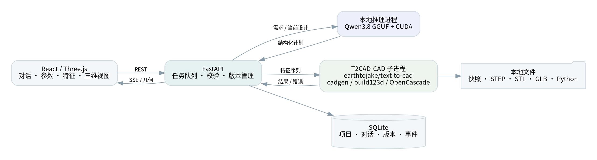
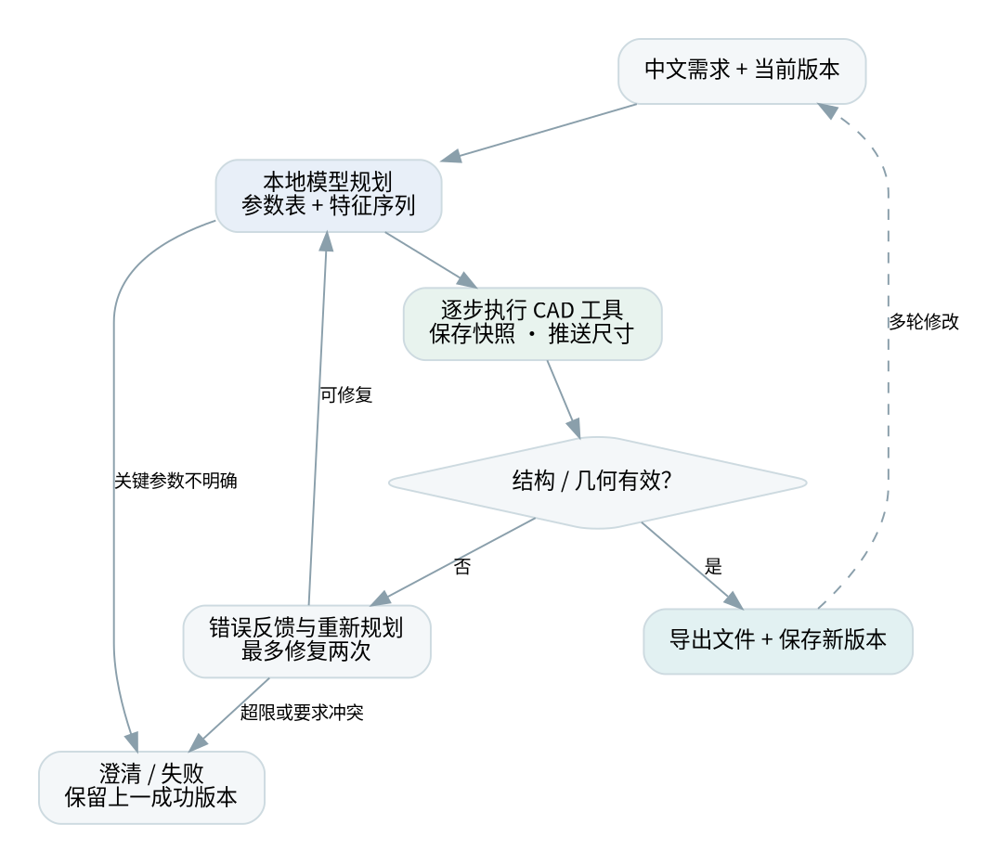
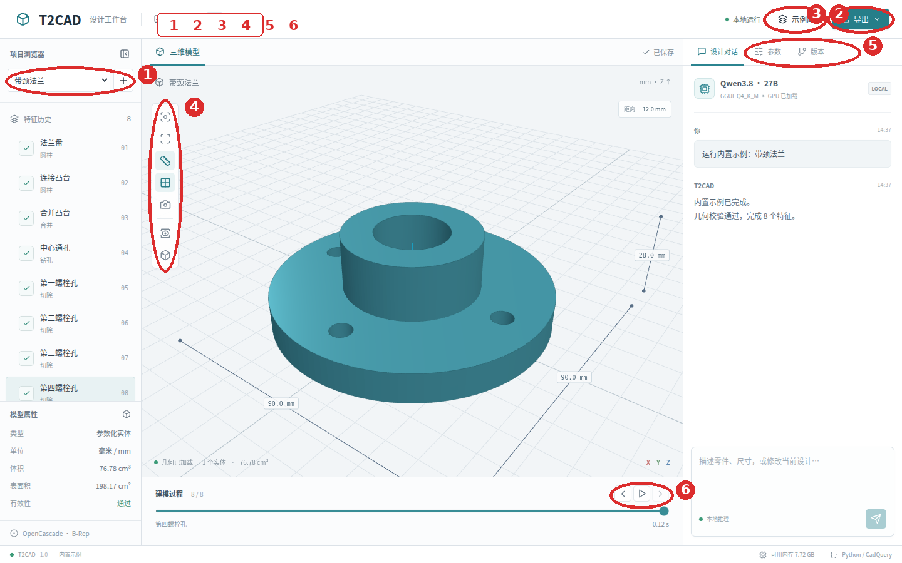
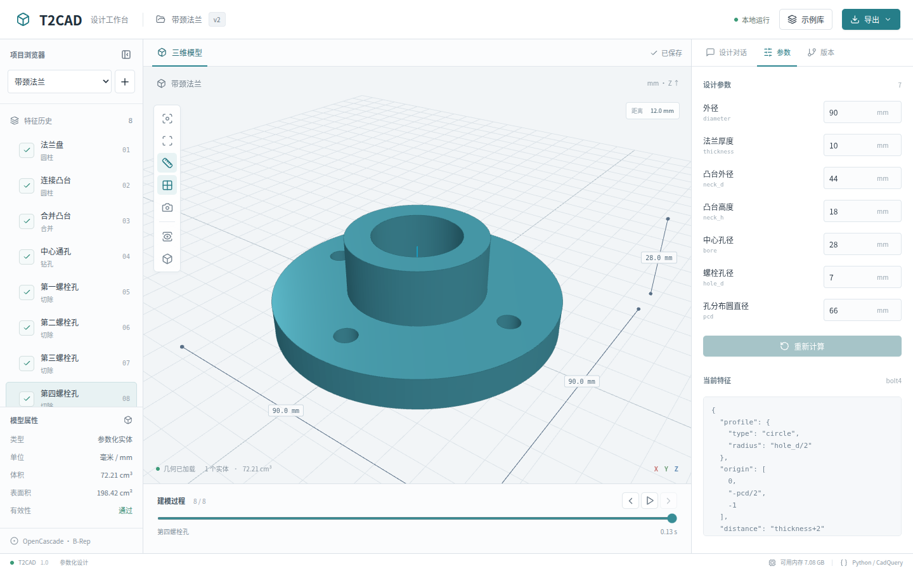
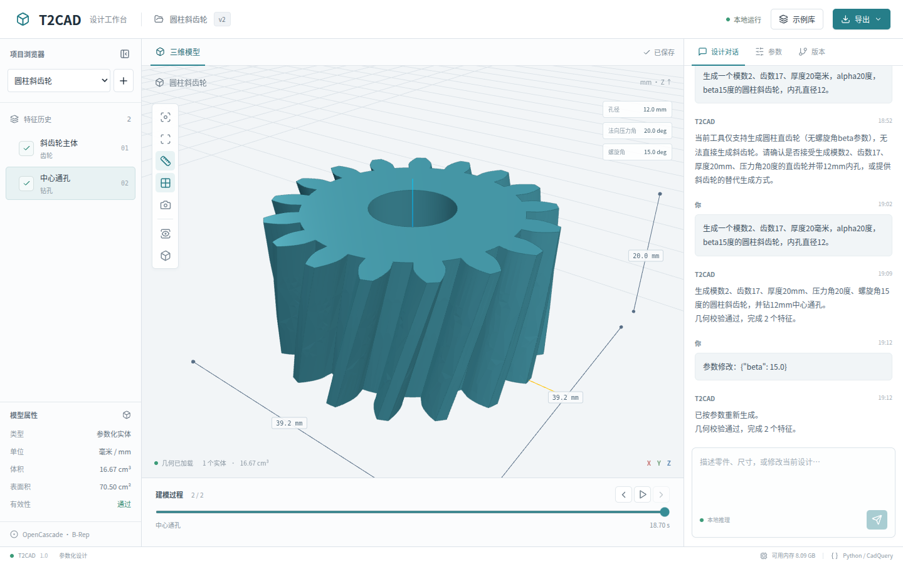
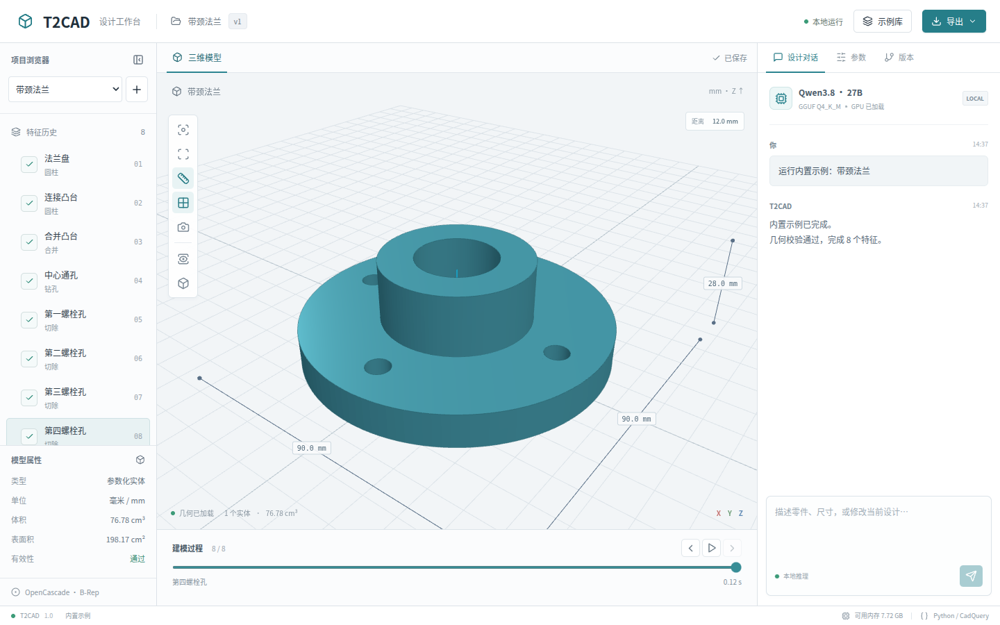

# T2CAD：本地大模型驱动的参数化零件生成 CAD 原型系统

CAD 技术课程实验报告

姓名：________　学号：________　课程：________

## 摘要

面向机械零件概念设计与教学演示，本文设计并实现一个前后端分离的本地 CAD 原型。系统通过 Qwen3.8 语言模型将中文需求转化为参数表和顺序特征计划，由 Python 工具执行器调用 earthtojake/text-to-cad 的 cadgen / build123d / OpenCascade 生成边界表示实体，并向网页三维工作台持续推送实际建模过程。系统支持多轮修改、直接编辑参数、版本回退和多格式导出。推理采用 GGUF 量化权重直接加载，不依赖云端 API 或 Ollama。通过几何有效性检查、结构化错误反馈与有限次重新规划，系统将自然语言交互和确定性的 CAD 几何计算连接起来。

关键词：参数化建模；自然语言 CAD；大语言模型；工具调用；OpenCascade；本地推理

## 1 产品对象、应用场景与 CAD 需求

### 1.1 产品对象与场景特点

研究对象为安装板、法兰、阶梯轴套、L 形支架和仪器壳体等典型机械零件。这些零件通常由少量有明确尺寸的平面、圆柱面、孔槽和倒圆角构成，具有加工特征清晰、设计参数可解释、同类零件尺寸变化频繁等特点。课程教学不仅需要看到最终外观，还需要理解草图、拉伸、切除、连接和修饰等步骤如何形成最终结构。

在概念设计阶段，设计者常以自然语言描述总体外形与尺寸，并在看到模型后持续调整局部细节。传统交互要求设计者手动选择工作平面、创建草图、设置特征和维护历史树，具有一定学习成本；单纯文本生成网格则不容易保留精确尺寸和可重建的工程参数。

### 1.2 设计技术现状

传统参数化 CAD 已形成成熟的特征历史、边界表示和几何内核体系。脚本式 CAD 把建模过程表达为程序，便于自动化、批量变型和版本管理[3]。近年来，Text2CAD 研究文本到顺序 CAD 操作的生成[1]；Text-to-CadQuery 探索利用程序表示及大模型的代码生成能力描述 CAD[2]。SketchGraphs 将参数化草图表示为几何约束图，为约束推断和草图生成提供了大规模数据基础[23]；SketchGen 进一步研究了带约束草图的序列生成[24]；DeepCAD 把 CAD 操作序列看作一种结构化形状表示[25]。研究系统的目标和评价设置各不相同，本报告把相关研究作为方法依据，而把本系统的几何回归和真实交互作为实验事实。

本原型采用现成通用语言模型作为规划器，并通过受约束的操作集合执行几何任务。相比训练专用 CAD 模型，该方案的部署和数据准备成本更低，但泛化能力受操作范围、提示词和推理模型能力共同限制。这个选择与 CAD 领域长期强调的“设计意图、约束和可编辑历史”是一致的：系统的重点不是把一句话变成一张漂亮的网格，而是让尺寸、特征和修改关系可以被追踪[4][5][10]。

### 1.3 系统需求

功能需求包括中文描述生成零件、参数集中管理、逐步显示建模几何、尺寸显示、多轮修改、错误反馈、版本保存和 STEP/STL 等文件导出。非功能需求包括本地运行、前后端分离、任务可取消、失败可恢复、安装过程可复现，以及在 RTX 3090 24GB 与约 16GB 系统内存的机器上运行。

## 2 核心方法、原理及必要性

### 2.1 参数化特征建模

将零件定义为参数集合 P 与有序特征集合 F。第 i 个特征使用已有几何和参数产生新的形状：Sᵢ = fᵢ(S₀…Sᵢ₋₁, P)。参数修改后重新执行特征序列，即得到尺寸一致的新版本。参数名采用英文标识，界面标签使用中文；表达式只允许参数引用与基本算术。

系统以 B-Rep 精确实体作为主模型，显示时将实体离散为三角网格。STEP 用于交换精确实体，STL/GLB 用于网格显示或后续应用。参数历史单独保存在设计 JSON 与数据库中，不能认为 STEP 天然保留本系统的特征历史。B-Rep 的拓扑结构、曲面边界和实体有效性检查分别承担不同职责，这也是 Open CASCADE 这类几何内核适合课程原型的原因[4]。BRepNet 说明了直接利用 B-Rep 拓扑关系进行学习的价值[26]，SolidGen 则展示了直接生成顶点、边和面的另一条路线[27]；本系统选择保留参数特征序列，再由内核生成 B-Rep。

当前实现统一使用 earthtojake/text-to-cad 发布的 cadgen 0.7.24，采用其 build123d 原生几何接口和 `@step/@stl/@glb` 导出接口[19][20]。此项目与同名 Text2CAD 论文及 MLYengineering/Text2CAD 不同。草图、拉伸、旋转、孔、布尔、倒角与阵列统一在新执行层完成；直齿轮采用 bd-warehouse 0.3.0 的渐开线齿轮实现，避免语言模型用圆柱或任意多边形代替齿形[21]。可继续在齿轮上组合孔等特征。浏览器显示采用 Three.js 的 WebGL 渲染和轨道交互[22]。

圆柱斜齿轮复用渐开线端面齿廓与 build123d 的螺旋扫掠。默认采用法向制：mₜ=mₙ/cosβ，tanαₜ=tanαₙ/cosβ，分度圆直径 d=mₜz；厚度 h 对应的总扭转角为 θ=2h·tanβ/d（弧度）。因此螺旋角 β 不能直接当作上下端面的总扭转角。正负 β 分别生成右旋和左旋，内孔保持沿轴向的直通圆孔。系统也支持显式端面制输入，并记录制式与换算结果。齿廓未模拟滚刀齿根包络、变位或修缘。

### 2.2 大模型规划与执行反馈

大模型读取用户要求、当前设计和近期对话，生成结构化建模计划。输出受到 JSON Schema 约束，随后由 Pydantic 检查数据结构；工具执行器再校验参数和几何。模型负责选择操作、安排顺序及表达修改意图，几何内核负责执行数学运算。CadVLM 将视觉和语言结合到参数化草图生成中[28]，CADLLM 类工作把文本描述、建模序列预测和置信度结合起来[29]；FutureCAD 进一步探索了由 LLM 生成程序并对 B-Rep 选择进行文本 grounding[30]。本系统采用较小而明确的操作集合，强调课堂环境下的可解释执行。

工具执行出现异常时，系统把特征 ID、操作和结构化错误返回给规划器。系统允许有限次数的反馈式重新规划，并锁定用户明确指定的尺寸参数，避免通过改变尺寸掩盖几何问题。无法满足要求时应澄清或终止。该闭环能利用运行时反馈改善结果，但不保证任意描述均可成功。

实现中进一步检查参数是否实际被几何操作使用，以及最终包围尺寸是否符合设计文档中的目标尺寸。矩形四角孔与圆周孔采用通用布局工具计算位置，避免把坐标算术完全交给语言模型。纠错阶段增加有限的内部规划预算，并反馈各步骤的实际包围盒；最终输出仍为受约束的结构化设计。目标尺寸本身由规划器提取，因此这些检查不能取代独立的设计审核。

### 2.3 本地量化推理

当前默认模型为 Qwen3.8-27B Q4_K_M，GGUF 文件约 17.4GB。系统管理一个本地 llama.cpp CUDA server 子进程，通过仅回环监听和随机密钥的 HTTP 接口调用，模型权重全程在本机。默认上下文 8192 token、单模型单任务；使用顺序读取代替 mmap，降低 16GB 系统内存环境中的换页压力。模型只在首次使用时加载，之后复用常驻进程。

量化减少权重存储与显存需求，单进程模型复用避免重复加载。去掉额外模型服务路由简化了部署，但资源占用的主要决定因素仍是模型权重、KV 缓存、上下文长度和 GPU 卸载配置。Swap 只作为内存压力下的缓冲，不能替代显存，也不作为性能保证。

### 2.4 技术选择的必要性

参数化表示使多轮修改具有稳定的数据基础；精确几何内核提供实体运算和标准文件输出；结构化工具接口把语言生成与几何操作连接起来；执行反馈提供可定位的纠错依据；三维过程显示使自动建模具备教学可解释性。这些能力共同服务于“可生成、可观察、可修改、可验证”的课程目标。

### 2.5 斜齿轮方法的工程含义

本报告选择齿轮作为重点对象，是因为齿轮同时包含离散参数和连续几何。模数 m、齿数 z、压力角 α、螺旋角 β 和齿宽 h 具有明确的机械意义，任何一个参数改变都会影响齿廓、分度圆、啮合关系或轴向受力。对于法向制斜齿轮，端面模数满足 mₜ=mₙ/cosβ，端面压力角满足 tanαₜ=tanαₙ/cosβ，分度圆直径为 d=mₜz；这些换算关系在齿轮设计资料中有系统说明[11][12][13]。因此，语言模型不能只把 beta 当作一个显示标签，而必须把它传递给实际扫掠操作。

本系统的做法是先生成渐开线齿廓，再使用 build123d 的旋转拉伸形成螺旋齿面。厚度 h 对应的总扭转角为 θ=2h·tanβ/d，β 的正负表示左右旋。中心孔作为后续轴向切除特征生成，避免孔随齿廓扭转。这个实现适合课程中的参数化演示和标准零件概念设计，但不等价于完整的齿轮制造软件：没有加入齿根滚刀包络、变位系数、齿向修形、齿面接触分析和强度校核。机械传动设计中常用的啮合、接触比和承载校核应由专门工具或工程手册完成[12][13][14]。

## 3 CAD 系统方案

### 3.1 功能模块

系统分为项目管理、设计对话、模型规划、参数化几何执行、结果验证、三维显示、版本管理和文件导出八个模块。项目管理维护持久化设计；对话模块组织上下文；规划器输出操作序列；几何执行器逐步生成实体；校验模块检查实体与导出；工作台同步显示特征、尺寸和事件；版本模块支持回退；导出模块生成标准格式和重建脚本。

### 3.2 体系结构

前端使用 React 和 Three.js，通过 REST API 操作项目与任务，通过 SSE 接收过程事件。FastAPI 后端使用 SQLite 存储项目元数据，并在磁盘中按任务及尝试次数保存文件。推理进程与 CAD 子进程相互独立，避免 CAD 内核错误直接破坏模型进程。单任务队列限制资源竞争。

本次迁移保持前端和 Qwen3.8 模型不变。主服务运行在 T2CAD 环境，CAD 工作进程运行在独立的 T2CAD-CAD 环境，以隔离不同版本的 OpenCascade 绑定。所有最终格式由同一几何实体导出，保存 STEP 后使用 cadgen 独立回读验证；下载的 Python 程序包含参数、特征编译器和 cadgen 导出入口，可在独立环境直接重建。cadgen 遥测和后台 daemon 在本系统中关闭。

### 3.3 数据与接口

设计文档包括名称、参数列表和特征列表。每个特征有稳定 ID、名称、操作和参数；后续特征通过 ID 引用之前的结果。版本记录完整设计、父版本、几何指标和输出目录。任务事件保存顺序编号，浏览器重连可继续读取未接收事件。

核心接口包括 `/api/projects`、项目下的 `/messages` 与 `/parameters`、`/api/jobs/{id}/events`、版本恢复接口和 `/api/artifacts/...` 文件接口。修改请求必须带基准版本；过期版本提交返回冲突，防止覆盖较新的设计。项目管理还提供重命名和删除接口，删除操作同时清理项目消息、版本、任务和生成目录；进行中的任务需要先停止，避免文件写入与删除并发发生。这一设计把课程实验中容易忽略的生命周期管理纳入 CAD 原型，而不是只演示一次生成。

## 4 技术路线与实现流程

1. 用户提出零件需求，后端读取当前版本和近期对话。
2. 规划器给出完整参数化计划，或对关键歧义提出问题。
3. 校验结构后，CAD 子进程顺序执行草图、实体、布尔和修饰特征。
4. 每完成一个特征即保存 STL 快照，并发送特征参数、包围尺寸、体积和耗时。
5. 若几何校验不通过，执行有限次数的反馈式重新规划；成功时检查最终结果是一个有效连通实体。
6. 导出 STEP、STL、GLB、JSON 和独立 Python 脚本，并原子保存新版本。
7. 用户继续对话或直接改参数，系统基于选定版本重新执行上述流程。

尺寸测量直接使用底层曲面计算精确包围盒，避免显示用三角网格误差进入尺寸数据。建模工作进程默认超时为 180 秒；模型加载与推理分别设置超时。取消任务终止 CAD 进程组及其模型程序，保留历史成功版本；服务重启会把未完成任务标记为中断。本机存在 FreeCAD 时，可额外把导出的 STEP 转换为 FCStd 交换文档；该文档不包含原生 FreeCAD 参数特征树。这样的边界划分参考了 CAD 交换标准对几何实体和应用数据分离的思路[6][7]。

## 5 功能介绍与演示

### 5.1 工作台布局

图 3 对工作台的主要入口进行了标注。顶部的“示例库”用于快速打开标准零件案例，“导出”提供 STEP、FCStd、STL、GLB、Python 和 JSON 文件；左侧是项目与特征浏览区，中间是三维视口和建模过程，右侧是对话、参数、版本三个工作页签。工作台采用三栏布局，使零件形状、特征顺序和设计输入可以同时出现，适合课堂演示和重复修改。

### 5.2 项目浏览与设计对话

项目浏览器保存本地零件项目。用户可以新建项目、切换项目、重命名项目或删除不需要的零件；删除操作要求确认，并清理项目关联的版本和生成文件。设计对话框接受中文描述，例如“生成一个长100、宽60、厚8毫米的安装板，四角有直径6毫米的通孔”。系统将描述送入本地 Qwen3.8，由模型整理参数和特征计划，再把计划交给 CAD 执行器。

对话区会显示规划摘要、特征完成事件、实际尺寸和保存状态。用户可以继续输入“把孔径改为8毫米，其他尺寸不变”，系统以当前版本为基准重新计算。对于参数含义不明确的描述，系统先询问必要信息，不直接生成无法解释的几何。这样的交互把 CAD 的设计意图保留在项目消息和参数文档中。

### 5.3 参数编辑与尺寸标注

图 4 展示参数页。每个参数同时显示中文标签、程序标识、数值和单位，例如 `hole_d` 表示孔径，`pcd` 表示分布圆直径。修改数值后点击“重新计算”，系统重新执行完整特征序列并生成新的版本。右侧参数面板适合精确修改，视口上的尺寸标注适合快速核对；两者来自同一份底层测量结果，不依赖网格估计。

对于齿轮，面板会显示模数、齿数、压力角、螺旋角、基圆直径和齿顶圆直径。斜齿轮的 beta 使用角度单位，正值表示右旋、负值表示左旋，改变 beta 后会重新生成螺旋齿面。中心孔作为独立特征显示在左侧特征树中，便于检查它是否真正参与最终实体。

### 5.4 特征历史与过程回放

特征历史以顺序树显示每个建模操作，点击某一项即可查看该步骤的 STL 快照和包围尺寸。底部时间轴可以逐步播放模型从毛坯到最终零件的变化，也可以切换线框、网格、标准视图和适配视图。这个功能把“特征顺序”从数据库中的抽象记录变成可观察的教学过程：学生能看到法兰先生成圆盘和凸台，再进行合并、中心孔和螺栓孔加工。

### 5.5 版本管理与标准文件导出

版本页保存每次成功计算的设计文档、父版本和变化摘要。用户可以回到任意版本继续修改，参数冲突时系统要求以当前版本为基准，避免覆盖其他修改。导出菜单提供精确实体 STEP、FreeCAD 交换文档 FCStd、显示网格 STL/GLB、可重建 Python 和参数 JSON。STEP 适合在 FreeCAD 中继续检查，STL 适合打印或网格处理，GLB 适合浏览器和演示，Python/JSON 适合实验复现。

### 5.6 典型零件案例

系统内置五类案例，覆盖基础实体、孔加工、同轴结构、布尔合并和腔体切除。

|案例|主要功能|建模特点|典型用途|
|---|---|---|---|
|四孔安装板|矩形实体、四角孔、参数重算|孔中心由边距自动计算|设备底板、安装支架|
|带颈法兰|圆柱、合并、中心孔、圆周孔|适合观察多级特征依赖|管路连接、法兰盘|
|阶梯轴套|旋转体、同轴孔、不同高度|展示旋转剖面和孔加工|轴端定位、轴套|
|L形安装支架|多平面拉伸、布尔合并、加强筋|展示非共面特征|机架连接件|
|开口仪器壳体|外壳、腔体、开口切除|展示薄壁和开口设计|电子设备外壳|

安装板适合第一次演示：输入长度、宽度、厚度、孔径和边距后，可以马上看到四个孔的位置。法兰适合展示参数页和特征回放，修改中心孔径后只改变相关切除特征。轴套和支架适合讲解工作平面、旋转轴和布尔运算；仪器壳体适合说明实体有效性和腔体切除。五类案例的精确尺寸、体积、STEP 回读和 STL 水密性见第 6 章的鲁棒性验证表。

### 5.7 齿轮案例演示

图 5 是完整的斜齿轮演示。输入“模数2、齿数17、厚度20毫米、alpha20度、beta15度、内孔直径12”后，系统生成法向制右旋斜齿轮，并在特征树中分别显示斜齿轮主体和中心通孔。把 beta 修改为 -15 度后，齿面旋向改变，模数、齿数、厚度和孔径保持不变。这个案例集中展示了自然语言输入、角度参数、螺旋扫掠、参数重算和导出文件之间的关系。

<!-- MEASUREMENTS -->

## 6 系统鲁棒性分析与验证

### 6.1 验证目标与评价指标

本实验围绕四个问题展开。第一，受约束的参数化执行器能否稳定生成常见机械零件，并输出可回读的标准文件？第二，本地 Qwen3.8 能否把中文需求转换为包含参数引用和特征依赖的设计？第三，执行错误能否以特征级信息反馈给规划器，而不通过篡改用户尺寸来“修复”结果？第四，针对斜齿轮的 beta 修改能否保持孔径、齿数和厚度不变？

对应地，实验记录五类指标。几何有效性包括实体是否为非空单实体、OpenCascade 有效性和 STL 水密性；尺寸一致性包括精确包围盒和目标高度；交换一致性包括 STEP 回读体积误差、GLB 单位换算和独立 Python 脚本重建；交互一致性包括参数修改、版本恢复、取消、删除和重命名；模型身份包括健康接口中的实际模型名、是否发生回退以及推理耗时。将这些指标分开，是为了避免把“模型生成了一个形状”“形状可以打开”和“形状符合用户语义”混成一个成功率。

### 6.2 确定性零件回归

五类内置零件覆盖安装板、法兰、阶梯轴套、L 形支架和仪器壳体，特征数量从 3 到 8 个不等。安装板测试四角孔布局和孔径变化；法兰测试多级圆柱合并、中心孔和圆周孔；轴套测试旋转体与同轴孔；支架测试不同工作平面和加强筋；壳体测试开口切除。每个案例均由同一设计 JSON 进入 cadgen 工作进程，导出 STEP、STL、GLB 和 Python 脚本，然后重新读取 STEP 并执行脚本。

从结果看，五类零件的目标包围尺寸分别为 100×60×8、90×90×28、48×48×45、80×50×61 和 100×70×35mm，STEP 回读相对体积误差均为 0，STL 均为水密网格。这里的 0 是在当前文件回读精度下的相对误差，不表示制造测量精度。单个 CAD 工作进程的构建与导出时间约为 1.4–2.0 秒，主要成本来自首次加载 cadgen 运行环境，而非布尔运算本身。详细数据见第5.3节表格。

图 3 以工作台界面展示最终模型和尺寸标注。它并不是新的测试样本，而是把验证数据映射到用户能够检查的视图中：左侧特征树显示执行顺序，中间视口显示网格，右侧参数和对话保留设计上下文。这样的界面组织符合工程 CAD 中“特征历史、几何视图、参数编辑并列”的使用习惯[8][9]。

### 6.3 直齿轮与斜齿轮实验

直齿轮实验使用法向模数 2、17 齿、厚度 20mm。工具使用 bd-warehouse 的渐开线齿廓，不把齿轮简化为圆柱或矩形阵列。在分度圆上逐齿采样，齿厚内侧点应位于实体内，齿槽外侧点应位于实体外；随后切除直径 8mm 的中心孔，体积减少量与 πr²h 一致。这一测试检查了齿形和孔特征是否真的参与最终实体。

斜齿轮实验使用法向模数 2、齿数 17、厚度 20mm、法向压力角 20°、螺旋角 15°、中心孔 12mm。真实结果的端面模数为 2.070552、端面压力角为 20.646896°、分度圆直径为 35.199390mm、齿顶圆直径为 39.199390mm、总扭转角为 17.446163°。右旋版本体积为 16668.7273mm³，改为左旋后体积为 16668.7273mm³，差异在浮点误差范围内；厚度仍为 20mm，孔径仍为 12mm。右旋与左旋的齿面在不同高度位置的采样结果相反，说明 beta 被用于几何扫掠，而不是只进入结果文本。

图 4 是真实 Qwen3.8 规划并由新 CAD 核心生成的斜齿轮。画面中可以同时看到倾斜齿面、中心通孔、法向压力角和螺旋角。移动视口也通过了非空像素、旋转和参数面板检查，说明同一份参数化结果可以在不同屏幕尺寸下复核。

### 6.4 本地模型交互实验

Qwen3.8 的第一轮请求从文本生成参数、齿数、压力角、螺旋角和孔特征；模型输出经过 JSON Schema 和 Pydantic 检查后才进入 CAD 工作进程。第一次冷启动需要读取约 17.4GB 的 GGUF 权重，实测约 256 秒；模型进入常驻状态后，斜齿轮第一轮规划、执行和导出总耗时约 439 秒，其中主要时间来自冷启动和 cadgen 的 STEP/GLB 导出。第二轮把 beta 从 15°改为 -15°，总耗时约 89 秒，没有发生模型回退，也没有修改其他尺寸。

这个结果说明本地部署的瓶颈首先是权重加载和磁盘读写，其次才是语言模型生成。对于课堂演示，可以先启动服务并等待模型就绪，再演示多轮修改；对于批量变型，可以复用常驻模型和独立 CAD 环境。Qwen3.8 的使用方式参考了 Qwen 模型的指令跟随和结构化输出能力[15][16]，但本实验不把通用模型的能力描述成专用 CAD 模型的训练效果。

### 6.5 边界输入与状态一致性

鲁棒性验证覆盖三类输入边界。第一类是表示边界：未知包围尺寸统一使用 JSON `null`，参数表达式只允许参数名和四则运算，非法名称、空表达式和除零会在进入几何内核前被拒绝。第二类是几何边界：孔径、齿数、压力角、螺旋角、圆角半径和阵列数量都有范围检查，最终实体必须为非空、有效的单实体。第三类是状态边界：项目重命名和删除要求没有进行中的任务，参数修改必须携带当前版本，取消任务后保留上一成功版本。

结构化输出校验、参数校验和 B-Rep 几何校验形成三层防线。第一层检查字段和类型，第二层检查设计语义能否转成受限操作，第三层检查实体、包围盒、体积和导出文件。三层检查各自处理不同问题，避免让某一个模块承担全部可靠性责任。该设计也便于定位问题：输入问题停留在 API 层，特征问题出现在 CAD 工作日志，文件问题由 STEP 回读和网格检查报告。生成—执行—反馈的循环与程序合成研究中将计算过程显式化的思路相近[1][2][17]。

### 6.6 项目生命周期与可复现性

项目管理实验新增了重命名和删除。重命名后再次生成不会被设计名覆盖；删除操作需要二次确认，且会清理项目关联的消息、版本、任务和生成目录。对进行中任务的删除和重命名返回冲突，必须先停止任务。这个约束看似属于界面细节，实际上关系到实验数据的完整性：如果生成进程仍在写入 STEP，而项目目录已被删除，数据库和文件系统就会出现无法解释的残留状态。

可复现性实验还验证了独立 Python 脚本。脚本内嵌设计 JSON 和特征编译器，在 T2CAD-CAD 环境中再次执行，STEP 回读体积相对误差小于 10⁻⁷。依赖版本、上游来源和许可证记录在 `vendor/earthtojake_text_to_cad/SOURCE.json` 中；cadgen 遥测、更新检查和后台 daemon 均关闭。软件工程中，锁定依赖和保存输入是可重复实验的基本条件[18][19]。

### 6.7 可复现实验与结果解释范围

本实验可以支持以下结论：受约束的参数化执行器能够稳定完成报告选定的基础机械零件；Qwen3.8 能够在本地硬件上生成结构化参数和特征；斜齿轮 beta 变化能够反映到真实齿面旋向；标准文件和重建脚本能够通过自动化回归。实验不能支持“任何自然语言都能一次生成”“几何有效就一定符合制造意图”或“当前齿轮模型已经完成强度认证”等更强结论。

## 7 设计取舍、问题与改进方向

### 7.1 为什么采用双进程和两套 Python 环境

Qwen3.8 需要 CUDA 推理和较大的上下文，CAD 内核则需要稳定的 OpenCascade Python 绑定。把两者放在同一进程中，模型崩溃、内存峰值和 CAD 内核异常会互相影响；把 cadgen 放入独立的 T2CAD-CAD 环境，可以让主 API 保持轻量，也方便对 CAD 进程设置地址空间上限。代价是首次启动要准备两套依赖，进程间需要通过 JSON、SSE 和文件目录传递数据。对于单用户课程原型，这个代价是可以接受的。

### 7.2 为什么不让模型直接生成任意 Python

任意代码生成看起来灵活，但会带来不可控的文件访问、网络调用、无限循环和难以解释的几何结果。当前系统只允许有限的 box、cylinder、gear、extrude、revolve、hole、布尔、圆角、倒角和阵列操作，数值表达式限制为参数名和基本四则运算。受限操作集合降低了表达能力，却换来了可审计的输入、统一的错误消息和可测试的几何行为。未来可以通过经过审核的新操作扩展能力，而不是开放一个没有边界的解释器。

### 7.3 面向课程教学的价值

这套系统适合作为 CAD 方法课程的综合实验。学生可以从同一份需求观察五个层次：产品需求如何转成参数，参数如何组织成特征，特征如何由几何内核执行，执行结果如何通过标准格式交换，以及错误如何在下一轮对话中被定位。与只展示最终 STL 相比，过程事件、包围盒、体积、版本和脚本重建使设计过程更容易复盘。报告中的架构图、流程图、界面截图和斜齿轮案例可以直接对应课程要求中的系统方案、技术路线和结果展示。

### 7.4 后续改进

第一，加入草图约束求解和稳定拓扑引用，减少复杂修改时面和边选择器失效。第二，加入齿轮啮合检查、接触比、齿根强度和轴向力估算，使斜齿轮结果能够进入初步工程校核。第三，增加装配层和多零件坐标系，让“齿轮—轴—轴承座”成为可验证的系统。第四，建立包含歧义、单位换算和边界输入的中文 CAD 测试集，比较不同模型在结构化计划、几何有效性和尺寸语义上的差异[1][2][20][23][24][25][28][29]。第五，为项目文件增加导入、归档和权限边界，以支持多人课程作业管理。对于更复杂的工业零件，可研究 B-Rep 直接学习[26][27]和程序生成结合拓扑 grounding 的混合方案[30]。

## 8 总结

本原型完成了中文需求、结构化规划、精确建模、过程显示、交互修改与文件导出的闭环。设计状态以参数化文档持久化，使自然语言交互可以落到可重建、可比较和可回退的 CAD 结果上。课程价值在于展示语言模型与传统 CAD 内核的职责分工，以及如何通过执行反馈建立可观察的自动建模流程。

局限包括操作集合有限、复杂曲面的支持不足、没有完整草图约束求解和装配系统，以及几何有效性不能全面证明语义符合性。后续可以增加拓扑引用稳定性、约束求解、视觉几何检查、装配关系和针对机械设计的模型适配。未经工程审核的自动生成结果不直接作为制造依据。

## 9 参考文献

1. Khan M. S., et al. Text2CAD: Generating Sequential CAD Models from Beginner-to-Expert Level Text Prompts. arXiv:2409.17106, 2024. https://arxiv.org/abs/2409.17106
2. Text-to-CadQuery: A New Paradigm for CAD Generation with Scalable Large Model Capabilities. arXiv:2505.06507, 2025. https://arxiv.org/abs/2505.06507
3. CadQuery Contributors. CadQuery Documentation. https://cadquery.readthedocs.io/en/stable/
4. Open CASCADE Technology. Modeling Data and Modeling Algorithms. https://dev.opencascade.org/doc/overview/html/
5. ISO 10303-242:2022. Industrial automation systems and integration — STEP application protocol for managed model-based 3D engineering.
6. ISO 10303-21:2016. Industrial automation systems and integration — STEP implementation methods.
7. ASTM International. ASTM F2792-12a: Standard Terminology for Additive Manufacturing Technologies, 2012.
8. Braid I. C. Designing with volumes: the CAD paradigm. PhD thesis, University of Cambridge, 1978.
9. Requicha A. A. G. Representations for rigid solids: theory, methods, and systems. ACM Computing Surveys, 1980, 12(4): 437–464.
10. Shah J. J., Mäntylä M. Parametric and Feature-Based CAD/CAM. Wiley, 1995.
11. KHK Gears. Calculation of Gear Dimensions, Section 4.3 Helical Gears. https://khkgears.net/new/gear_knowledge/gear_technical_reference/calculation_gear_dimensions.html
12. Litvin F. L., Fuentes A. Gear Geometry and Applied Theory. Cambridge University Press, 2004.
13. Dudley D. W. Handbook of Practical Gear Design. McGraw-Hill, 1984.
14. ISO 6336-1:2019. Calculation of load capacity of spur and helical gears — Basic principles.
15. Qwen Team. Qwen3 Technical Report. arXiv, 2025. https://arxiv.org/
16. Qwen Team. Qwen3-27B-GGUF Model Card. https://huggingface.co/Qwen
17. Chen Z., et al. Program of Thoughts Prompting: Disentangling Computation from Reasoning for Numerical Reasoning Tasks. arXiv:2211.12588, 2022.
18. Abetlen et al. llama-cpp-python. https://github.com/abetlen/llama-cpp-python
19. Thompson Labs LLC. text-to-cad / cadgen. https://github.com/earthtojake/text-to-cad
20. Gumyr et al. build123d. https://github.com/gumyr/build123d
21. Gumyr et al. bd-warehouse. https://github.com/gumyr/bd_warehouse
22. Three.js Contributors. Three.js Documentation. https://threejs.org/docs/
23. Seff A., Ovadia Y., Zhou W., Adams R. P. SketchGraphs: A Large-Scale Dataset for Modeling Relational Geometry in Computer-Aided Design. arXiv:2007.08506, 2020. https://arxiv.org/abs/2007.08506
24. Para W. R., Bhat S. F., Guerrero P., Kelly T., Mitra N., Guibas L., Wonka P. SketchGen: Generating Constrained CAD Sketches. arXiv:2106.02711, 2021. https://arxiv.org/abs/2106.02711
25. Wu R., Xiao C., Zheng C. DeepCAD: A Deep Generative Network for Computer-Aided Design Models. ICCV 2021. https://arxiv.org/abs/2105.09492
26. Lambourne J. G., Willis K. D. D., Jayaraman P. K., Sanghi A., Meltzer P., Shayani H. BRepNet: A Topological Message Passing System for Solid Models. arXiv:2104.00706, 2021. https://arxiv.org/abs/2104.00706
27. Jayaraman P. K., Lambourne J. G., Desai N., Willis K. D. D., Sanghi A., Morris N. J. W. SolidGen: An Autoregressive Model for Direct B-rep Synthesis. arXiv:2203.13944, 2022. https://arxiv.org/abs/2203.13944
28. Wu S., Khasahmadi A., Katz M., Jayaraman P. K., Pu Y., Willis K., Liu B. CadVLM: Bridging Language and Vision in the Generation of Parametric CAD Sketches. arXiv:2409.17457, 2024. https://arxiv.org/abs/2409.17457
29. Liao J., Xu J., Sun Y., et al. Automated CAD Modeling Sequence Generation from Text Descriptions via Transformer-Based Large Language Models. arXiv:2505.19490, 2025. https://arxiv.org/abs/2505.19490
30. Li J., Zhang Q., Chen Q., et al. Towards High-Fidelity CAD Generation via LLM-Driven Program Generation and Text-Based B-Rep Primitive Grounding. arXiv:2603.11831, 2026. https://arxiv.org/abs/2603.11831

文献、模型与软件版本应结合随工程提供的锁定文件和实测记录复核；本报告未使用这些论文的数据集指标代替本系统测量结果。文中编号引用用于说明方法来源和工程背景，实验结论只由本项目保存的脚本、日志、几何文件和浏览器验收记录支持。
